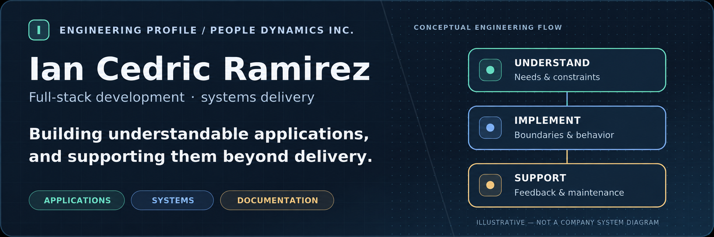
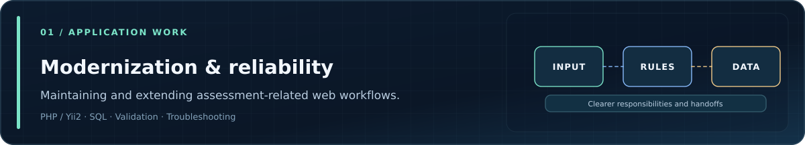
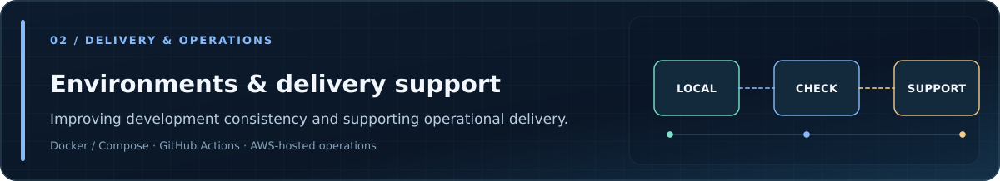
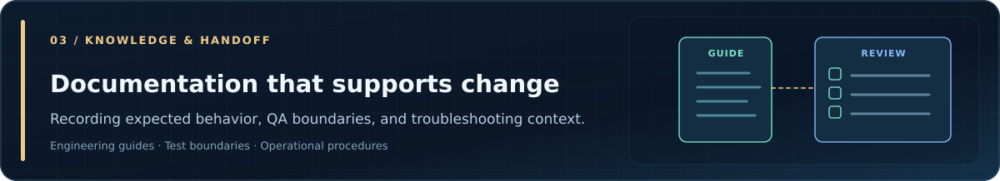
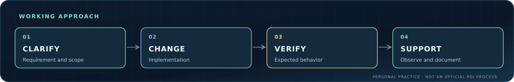

<!-- Personal GitHub profile for Ian Cedric Ramirez's company-facing account. -->

  

  <a href="https://ianramirez.nyebecreations.click/">Portfolio</a>
  &nbsp; · &nbsp;
  <a href="https://ianramirez.nyebecreations.click/pages/experience/">Professional Experience</a>
  &nbsp; · &nbsp;
  <a href="https://www.linkedin.com/in/ian-cedric-ramirez/">LinkedIn</a>

### About my work

I'm a full-stack engineer at **People Dynamics Inc.**, contributing to the maintenance and modernization of web applications and supporting development and delivery operations. My day-to-day work includes investigating application issues, improving code organization, working with database-backed workflows, and maintaining technical documentation.

I approach engineering by understanding **the business requirement, current system behavior, operational constraints, and the cost of change** before choosing an implementation.

### Engineering contributions

  

  

  

These illustrations describe **areas of contribution**, not PDI's internal architecture, infrastructure topology, or an official company workflow. Product-specific implementation details and private repositories are intentionally omitted.

### Technologies in context

| Area | Technologies and practices |
| --- | --- |
| **Application development** | PHP, Yii2, JavaScript, SQL, REST APIs, layered application design |
| **Data & services** | MySQL, Redis, database-backed application workflows |
| **Development & delivery** | Docker, Docker Compose, Git, GitHub Actions, AWS-hosted application support |
| **Verification & handoff** | Debugging, API testing, structured documentation, QA and troubleshooting guides |

### How I approach engineering work

  

I value **traceable changes, explicit responsibilities, practical testing, and documentation** that helps the next person understand why a system behaves the way it does.

### Professional background

- **People Dynamics Inc.** — Full-stack engineering with DevOps responsibilities · 2025–present
- **FEU Institute of Technology** — Software development instructor · 2023–2025
- **ILTN Holdings LLC** — Web development and IT operations (contract) · 2025

---

  Personal technical profile. No proprietary source, internal system diagrams, or confidential customer details are shared here.

